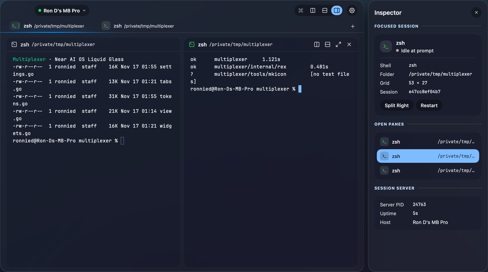

# Multiplexer

A native macOS and cross-platform terminal multiplexer of tabs and split panes,
written in pure Go with [MyGo](https://mygo.egoist.dev)'s native GPU UI and
Ghostty's `libghostty-vt` terminal emulator, styled to the **Near AI OS Design
System** and **Liquid Glass** architecture. No webview, no cgo: a single native
~15 MB app.



## Highlights

- **Near AI OS & TCDesign Liquid Glass.** Floating `20 pt` Liquid Glass panes
  backed on macOS 26+ by real AppKit `NSGlassEffectView` (`.regular`, tinted
  with `glassTint` under `glassVeil` and `paneFill`, with `10 pt` clear desktop
  gaps between panes), translucent `35%` `GlassCard` terminal surfaces, capsule
  `radius-pill` controls, and full support for **NEAR AI**, **Trace**, and
  **Classic Specular Glass** themes alongside **Reduce Motion**, **Reduce
  Transparency**, and **Increase Contrast**.
- **GlassRuleTabs & tool tiles.** Dedicated tab strip with a full-bleed `1 pt`
  rule across the pane, `26 pt` elliptical `tab-ember-halo` bloom, and `1.6×`
  `2 pt` `tab-ember` gradient line (`--spring-ember`), paired with `22 pt`
  `ink(0.10)` tool tiles showing each pane's foreground CLI tool. Tabs reorder
  by dragging, rename inline on double-click, and expose a native context menu.
- **Persistent sessions.** Shells run in a background session server of the
  same binary (`Multiplexer -server`). Quit Multiplexer and every program keeps
  running; reopen it and every tab, split, and pane reattaches right where you
  left it. The server maintains each session's screen in a headless
  `libghostty-vt` emulator so full-screen TUIs (`lazygit`, `vim`, `nvim`,
  `btop`) restore intact.
- **Live foreground activity & StatusLabels.** Each pane header tracks the
  foreground process (`Node`, `Claude Code`, `Codex`, `Git Changes`, `SSH`…)
  and working directory, pairing status dots with plain words (`Running`,
  `Needs a look`) and posting a desktop notification when a long command
  finishes in the background.
- **Host Popover, Floating Inspector & Command Palette.** Inspect machine
  hardware and session server health from the toolbar host pill, toggle the
  floating right-hand Session Inspector (`⇧⌘I`), or press `⇧⌘P` / `⌘P` for the
  floating blurred Command Palette with grouped `PANES` and `COMMANDS`, bold
  matched characters, and two-step `Esc` (clear query, then close).
- **Native Settings window (`⌘,`).** Single-instance macOS Settings window
  (`780 × 640`) with live session status chip and immediate persistence across
  **General** (Appearance, Theme & Material, Density, Reduce Transparency,
  Increase Contrast), **Terminal** (Font Size, Cursor Shape, Cursor Blink,
  Option as Meta), **Sessions**, and **About**.

## Shortcuts

| macOS | Windows, Linux | Action |
|---|---|---|
| `⌘,` | `Ctrl+,` | Settings |
| `⌘T` | `Ctrl+Shift+T` | New tab |
| `⌘D` / `⇧⌘D` | `Ctrl+Shift+D` / `Ctrl+Shift+E` | Split right / down |
| `⇧⌘I` | `Ctrl+Shift+I` | Toggle floating Session Inspector pane |
| `⌘W` / `⇧⌘W` | `Ctrl+Shift+W` | Close pane (or Settings window) / tab |
| `⇧⌘↩` | `Ctrl+Shift+Enter` | Zoom focused pane |
| `⌥⌘` arrows | `Alt+` arrows | Focus adjacent pane |
| `⌃⌘` arrows | `Alt+Shift+` arrows | Move nearest split divider |
| `⌃⌘=` | — | Equalize split panes |
| `⌘1`…`⌘9`, `⇧⌘[` `⇧⌘]`, `⌃Tab` | `Ctrl+Shift+1`…`9`, `Ctrl+PageUp/PageDown`, `Ctrl+Tab` | Switch tabs |
| `⇧⌘R` | `Ctrl+Shift+R` | Rename tab |
| `⇧⌘P`, `⌘P` | `Ctrl+Shift+P` | Command palette |
| `⌘K` | `Ctrl+Shift+K` | Clear screen and scrollback |
| `⌘+` `⌘−` `⌘0` | `Ctrl+=` `Ctrl+-` `Ctrl+0` | Terminal text size |
| `⌥⌘Q` | — | Quit and end all sessions |

On Windows and Linux, `Ctrl+<letter>` belongs to terminal programs (`Ctrl+C`,
`Ctrl+D`, `Ctrl+W`…), so Multiplexer's shortcuts include `Shift`
(`Ctrl+Shift+T`) and avoid `Ctrl+Alt` (`AltGr`).

## Develop and build

Multiplexer requires [Go](https://go.dev/dl/) 1.27+ and MyGo 0.3+, pinned as a
Go tool in `go.mod`:

```sh
go tool mygo dev       # Run Multiplexer Dev with live rebuilds
go test ./...          # Run unit, UI, session server, and WCAG contrast tests
go tool mygo build     # Package build/darwin-arm64/Multiplexer.app and Multiplexer 0.1.0.dmg
go run ./tools/mkicon  # Regenerate resources/icon.png (1024×1024 macOS squircle)
```

State (`layout.json`, `settings.json`, `server.sock`, and server logs) lives
in `~/Library/Application Support/Multiplexer` (`Multiplexer Dev` under
`mygo dev`, or `$MULTIPLEXER_DIR` when set).

## Architecture

| File | Purpose |
|---|---|
| `main.go` | Application lifecycle, Liquid Glass window setup, reconnect, and `-server` entrypoint |
| `tokens.go`, `style.go`, `widgets.go` | Near AI OS & TCDesign Liquid Glass tokens, themes, typography scale, materials, and UI primitives |
| `platform_darwin.go`, `platform_other.go` | macOS `NSGlassEffectView` pane backdrop pool and `NSWorkspace` Reduce Transparency detection via `purego/objc` |
| `view.go`, `tabs.go`, `host.go` | Toolbar, `GlassRuleTabs`, tool tiles, split pane cards, floating Session Inspector, PopoverNotice, Toasts, and Host Popover |
| `commands.go` | Idiomatic macOS menu bar (`Multiplexer`, `File`, `Edit`, `View`, `Tabs`, `Window`, `Help`) and Command Palette |
| `settings.go` | Live preference sync (`settings.json`) and single-instance native Settings window (`⌘,`) |
| `programs.go` | Foreground CLI recognition and contrast-verified light/dark tool tile tints |
| `state.go` | Split tree, terminal session attachment, layout snapshotting, and session polling |
| `internal/rex` | Persistent session server & client: PTYs, process inspection, headless VT snapshots, and Unix/named-pipe RPC |

Icons: [Lucide](https://lucide.dev) (ISC) and [Simple Icons](https://simpleicons.org) (CC0).
Fallback monospace font: [JetBrains Mono](https://www.jetbrains.com/lp/mono/) (OFL).
Brand lockups: NEAR AI official assets.
